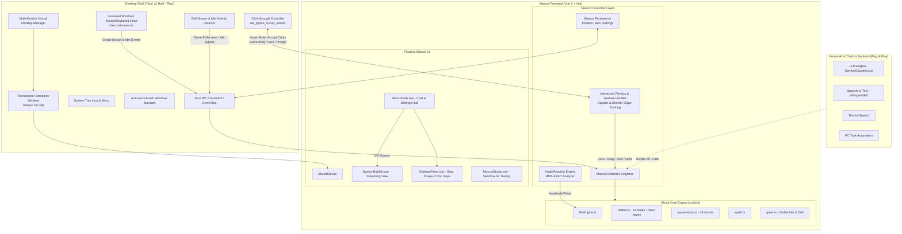

# Kế hoạch Triển khai: Desktop Mascot Framework Hoàn Chỉnh cho Bloub

## Trạng thái Môi trường Kỹ thuật (Đã Xác Minh Thành Công)
- **Rust Toolchain**: `rustc 1.99.0` / `cargo 1.99.0` (Target: `x86_64-pc-windows-msvc`).
- **MSVC C++ Linker**: Đã biên dịch & chạy thử nghiệm mã C++ / Rust native thành công 100%.
- **Tauri CLI**: `tauri-cli 2.12.2` sẵn sàng hoạt động.
- **Node.js**: v24.20.0, pnpm 11.17.0.
- **Frontend Core**: Vue 3.5 + Vite 8 + Vitest (211/211 tests passed).

---

## Mục tiêu Dự án (Goal Description)
Biến dự án **bloub** từ một web app trình diễn hoạt ảnh thành một **Desktop Mascot Framework** hoàn chỉnh, hoạt động độc lập trên màn hình máy tính với độ mượt mà tuyệt đối và tiêu tốn cực ít tài nguyên (~15-25MB RAM).

Mục tiêu cốt lõi của giai đoạn này là **tạo ra một "cái khuôn" hoàn hảo và chặt chẽ**:
- Xây dựng đầy đủ toàn bộ hệ thống cử chỉ, trạng thái, biểu cảm, phản xạ tương tác (click, drag, hover, click-through).
- Hỗ trợ hoàn hảo **Đa màn hình (Multi-monitor)** và **Nhận thức ngữ cảnh (Context & Inactivity Awareness)**.
- Xây dựng hệ thống phản ứng theo âm thanh (**Audio-Reactive Engine**) giúp bot co bóp nhịp thở tự nhiên theo giọng nói (TTS) và giọng người dùng (Mic) mà không cần vẽ thêm miệng.
- Cung cấp một bộ **Mascot Controller API** chuẩn mực, đóng gói sẵn toàn bộ phương thức điều khiển (`setState`, `setExpression`, `speak`, `listen`, `think`, `showBubble`, `lookAt`, v.v.).
- Tích hợp giao diện **Cửa sổ Tương tác Đa năng (Chat & Companion Hub)**: Vừa hỗ trợ hội thoại streaming token, vừa chứa **Trung tâm Cài đặt (Settings)** cho phép chỉnh kích cỡ, hình dáng, màu sắc, phím tắt và chế độ hệ thống.
- Thiết lập tài liệu tiến độ (`docs/progress.md`) và đặc tả API (`docs/mascot-framework.md`) để sau này bất kỳ backend AI/Chatbot nào (Gemini, Claude, Whisper, Ollama, LangChain, v.v.) đều có thể cắm vào (plug-and-play) một cách tức thì.

---

## Các Cơ chế Tương tác Đã Chốt (User Confirmed)

### 1. Cơ chế Click-Through Thông minh
- **Hit-test chính xác theo hình dạng SVG**:
  - Khi con trỏ chuột nằm **trong thân bot**: Tauri vô hiệu hóa `ignore_cursor_events` để nhận click, kéo thả, vuốt ve, chuột phải.
  - Khi con trỏ chuột nằm ở **vùng trong suốt xung quanh**: Tauri kích hoạt `set_ignore_cursor_events(true)` để mọi cú click chuột xuyên thấu xuống các cửa sổ ứng dụng (hoặc Desktop) bên dưới, không cản trở công việc của người dùng.

### 2. Tương tác Vật lý & Biến dạng Quán tính
- **Squash-and-Stretch khi kéo thả**:
  - Khi click giữ thân bot và di chuyển: Thân bot co giãn nhẹ thành hình giọt nước nghiêng theo vector vận tốc kéo (tạo cảm giác hữu cơ, mềm mại như thạch).
  - Khi nhả chuột: Thân bot có hiệu ứng nảy nhẹ (elastic recoil) trước khi ổn định lại hình tròn tĩnh.

### 3. Tự động Hít vào Mép Màn hình & Ngó nghiêng
- **Screen Edge Docking (Peek Mode)**:
  - Khi kéo bot đến sát mép màn hình (trái, phải hoặc đáy, cách mép < 30px): Bot tự động "hít" nhẹ vào cạnh viền.
  - Khi ở trạng thái dock mép: Bot thu gọn một nửa thân vào mép và chỉ thò mắt ra ngó nghiêng (peek) để tiết kiệm tối đa diện tích làm việc của màn hình. Khi người dùng rê chuột lại gần mép, bot tự động trồi ra chào đón.

### 4. Cửa sổ Tương tác Đa năng: Chat & Settings Hub
- **Vị trí & Cơ chế hiển thị**:
  - Neo bên cạnh thân bot, tự động đảo hướng (trên/dưới/trái/phải) để không bao giờ bị tràn ra ngoài màn hình.
  - Tự động đóng nhẹ nhàng khi bấm `Esc` hoặc click chuột ra ngoài.
- **Tab 1: Chat & Hội thoại (Mặc định)**:
  - Hiển thị văn bản dạng token streaming từng từ một kèm Markdown parser.
  - Khung gõ phím nhanh (Quick Input) + Nút bấm Mic để tương tác thoại.
- **Tab 2: Cài đặt & Tùy biến Mascot (Settings - Truy cập qua icon ⚙️)**:
  - **Kích thước bot (Size Slider)**: Trượt điều chỉnh trực quan từ 80px đến 220px.
  - **Hình dáng thân (Shape Picker)**: Lựa chọn 8 hình dáng có sẵn (`cercle`, `galet`, `squircle`, `capsule`, `triangle`, `hexagone`, `nuage`, `goutte`).
  - **Màu sắc (Color Palette)**: 12 bảng màu của bot.
  - **Biểu cảm nghỉ (Rest Expression)**: 16 sắc thái mắt mặc định.
  - **Hành vi hệ thống**:
    - Khởi động cùng Windows (Start with Windows): Bật / Tắt.
    - Tự động ngủ (Inactivity Sleep): 5 phút / 10 phút / Tắt.
    - Tự ẩn khi chơi Game toàn màn hình: Bật / Tắt.
    - Phím tắt gọi nhanh: `Ctrl+Shift+Space`.
    - Phím tắt ẩn khẩn cấp (Boss Key): `Ctrl+Shift+H`.

### 5. Hỗ trợ Đa Màn Hình Hoàn Chỉnh (Multi-Monitor Support)
- **Kéo thả xuyên màn hình**: Bot có thể di chuyển mượt mà từ Màn hình 1 sang Màn hình 2 mà không bị giới hạn cửa sổ.
- **Ánh nhìn toàn không gian ảo (Virtual Desktop Gaze)**: Dù con trỏ chuột di chuyển sang màn hình phụ, mắt bot ở màn hình chính vẫn tính toán đúng góc lệch không gian để dõi mắt nhìn theo.
- **Hít mép thông minh theo từng màn hình**: Nhận diện ranh giới vật lý của từng màn hình hiển thị để thực hiện hít mép (docking) chính xác.

### 6. Ghi Nhớ Cấu Hình Bền Vững (Data Persistence)
- Tự động lưu toạ độ `(x, y)` cuối cùng, màn hình hiện tại, kích thước, màu sắc, hình dáng và các tuỳ chọn vào file `mascot-settings.json` thông qua plugin store của Tauri.
- Khởi động lại máy bot sẽ xuất hiện chuẩn xác tại vị trí cũ với đúng diện mạo người dùng đã chọn.

---

## Kiến trúc Tổng thể (System Architecture)



---

## Đặc Tả Mascot Controller API (Khuôn Giao Tiếp Sẵn Sàng)

```typescript
export interface MascotSpeakOptions {
  text?: string
  audioSource?: HTMLAudioElement | AudioBuffer | string
  onProgress?: (token: string) => void
  onComplete?: () => void
}

export interface MascotListenOptions {
  onAudioData?: (amplitude: number) => void
  onStop?: () => void
}

export class MascotController {
  // Trạng thái Reactive
  readonly state: Ref<StateId>
  readonly expression: Ref<ExpressionId>
  readonly size: Ref<number>
  readonly shape: Ref<string>
  readonly color: Ref<string>
  readonly isSpeaking: Ref<boolean>
  readonly isListening: Ref<boolean>
  readonly isThinking: Ref<boolean>
  readonly isSleeping: Ref<boolean>
  readonly isDocked: Ref<boolean>
  readonly isHubOpen: Ref<boolean>

  // Điều khiển trạng thái & cảm xúc
  setState(state: StateId, duration?: number): Promise<void>
  setExpression(expr: ExpressionId): void
  setSize(sizePx: number): void
  setShape(shapeId: string): void
  setColor(colorId: string): void
  resetToIdle(): void

  // Tác vụ AI (Sẵn sàng cắm backend)
  listen(options?: MascotListenOptions): void
  stopListening(): void
  think(taskPrompt?: string): void
  speak(options: MascotSpeakOptions): Promise<void>
  stopSpeaking(): void

  // Ngủ & Thức dậy
  sleep(): void
  wakeUp(): void

  // Hít mép & Đổi vị trí
  dock(side: 'left' | 'right' | 'bottom'): void
  undock(): void
  moveTo(x: number, y: number, monitorIndex?: number): void

  // Ánh nhìn & Cử chỉ
  lookAt(globalX: number, globalY: number): void
  poke(): void
  dragStart(): void
  dragEnd(): void

  // Quản lý Cửa sổ Chat & Cài đặt
  openHub(tab?: 'chat' | 'settings'): void
  closeHub(): void
  toggleHub(): void

  // Tin nhắn & Streaming
  showBubble(message: string, options?: { autoHideMs?: number, stream?: boolean }): void
  appendBubbleToken(token: string): void
  hideBubble(): void
}
```

---

## Kế hoạch Kiểm thử & Đảm bảo Chất lượng (Verification)

1. **Unit & Logic Tests**:
   - Chạy test suite gốc: `npx pnpm test` (đảm bảo 211 tests hiện tại luôn pass).
   - Test mới: `MascotController.test.ts`, `AudioReactive.test.ts`.
2. **Visual & Interaction Verification (Desktop)**:
   - Cửa sổ trong suốt 100%, không bóng mờ, không viền đen.
   - Hoạt động mượt mà trên 2 màn hình: kéo bot từ màn 1 sang màn 2, mắt nhìn theo con trỏ chuột ở cả hai màn hình.
   - Click-through: Click xuyên qua khoảng không quanh bot, chỉ nhận tương tác khi bấm trúng thân bot.
   - Kéo thả tự do không lag, có squash-and-stretch hữu cơ; thả chuột gần mép tự hít vào cạnh.
   - Inactivity: Sau thời gian chờ, bot tự động ngủ, di chuột bot giật mình tỉnh dậy.
   - Cửa sổ Chat & Settings: Mở mượt mà, trượt đổi kích cỡ/màu sắc/hình dáng bot cập nhật tức thì, bấm ra ngoài tự đóng.
   - Boss key: Nhấn `Ctrl+Shift+H` ẩn/hiện bot tức thì.
   - Audio-Reactive: Thân bot co giãn chuẩn xác theo nhịp âm thanh phát ra từ loa và micro.
